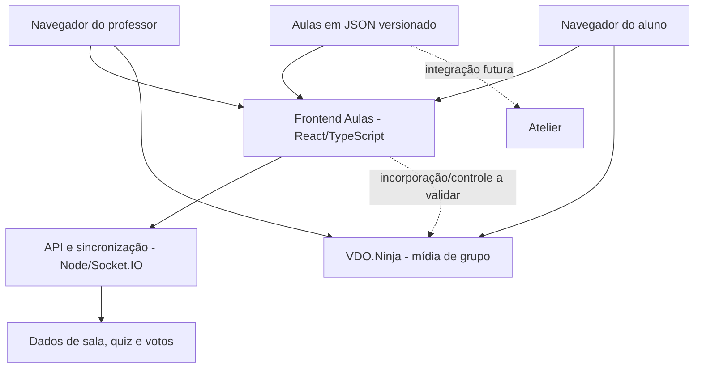

# Arquitetura inicial (proposta)

**Estado:** desenho técnico do Sprint 1. Implementação e integração audiovisual serão validadas a partir do Sprint 2.

## Diagrama lógico



No aplicativo, cada navegador carrega sua própria interface; o diagrama representa os componentes lógicos, não um único frontend compartilhado em execução.

## Separação de responsabilidades

1. **Frontend Aulas:** entrada, interface da chamada, controles, atividade atual e resultado.
2. **Serviço de atividades:** estado autoritativo da sala e do quiz; emissão dos eventos em tempo real; validação de permissões e votos.
3. **Persistência:** metadados mínimos da sala, conteúdo de atividade, respostas e expiração, conforme política definida.
4. **VDO.Ninja:** chamada de voz/vídeo entre participantes. Não armazenar mídia no backend Aulas.
5. **Formato JSON:** descreve atividades e planos de aula independentemente do player ao vivo e do Atelier.

## Proposta de estrutura de código futura

```text
aulas/
├── README.md
├── docs/
│   ├── VISAO.md
│   ├── REQUISITOS.md
│   ├── ARQUITETURA.md
│   ├── ROADMAP.md
│   └── TESTES.md
├── examples/
│   └── aula.exemplo.json
├── apps/
│   ├── web/                 # React + TypeScript + Vite (Sprint 2)
│   └── server/              # Node + TypeScript + Socket.IO (Sprint 2/4)
└── packages/
    └── shared/              # Tipos e validação de contratos (quando necessário)
```

Pastas apps/ e packages/ são **futuras**, não devem ser tratadas como implementação existente.

## Acesso sem cadastro: segurança real

- A sala recebe `roomId` aleatório, não sequencial. Não é credencial administrativa.
- Link do **aluno** permite participação; não deve conter segredos do professor.
- Link do **professor** contém segredo forte, de preferência no fragmento da URL (não enviado em requisições HTTP como parte do caminho/query); frontend troca o segredo por uma sessão curta via HTTPS. Evitar exposição em logs, histórico de analytics e sistemas externos.
- No servidor, armazenar apenas representação segura/verificador da credencial; exigir permissão de professor **em cada ação** de controle. O cliente jamais define seu próprio papel.
- Prever expiração, revogação e rotação dos links. Não considerar link secreto equivalente a login completo.
- Acesso à sala do VDO.Ninja e aos seus controles também precisa de configuração apropriada; não presumir que proteger somente Socket.IO impeça entrada direta por links externos.
- Considerar senhas de sala, bloqueio/moderação e separação de links nativos conforme suporte confirmado pelo VDO.Ninja.
- Definir limitações e riscos da participação anônima: nomes não são prova de identidade.

## Estado de quiz sugerido

```text
DRAFT -> OPEN -> CLOSED -> REVEALED
```

O professor pode abrir, encerrar e revelar; apenas participantes autorizados respondem enquanto OPEN. A decisão final é do servidor. Cada voto tem chave de idempotência por participante/sessão/quiz. Reconexões solicitam o estado atual e não disparam votos extras.

## Eventos conceituais (a definir em contrato)

- `room:join` → retorna status da sala e papel validado.
- `quiz:open` (professor) → publica quiz aos participantes.
- `quiz:submit` (aluno) → valida alternativa e confirma recebimento.
- `quiz:progress` → totais para o professor, sem expor respostas individuais por padrão.
- `quiz:close` (professor) → bloqueia novos votos.
- `quiz:reveal` (professor) → libera resultado.
- `room:state` → snapshot da atividade e participantes autorizados após reconexão.

São **nomes de proposta**, não API implementada.

## Integração com VDO.Ninja

A incorporação deve ser validada no Sprint 2 com áudio/vídeo e múltiplas câmeras, incluindo permissões de iframe, layouts, dispositivos móveis, moderação e compatibilidade. A API de iframe não substitui servidor de estado de quizzes. Não gerar credenciais ou assumir parâmetros de salas sem consultar e testar a documentação atual.

Documentação de referência:
- https://docs.vdo.ninja/getting-started/rooms
- https://docs.vdo.ninja/guides/iframe-api-documentation

## Dados e privacidade

Dados mínimos previstos: ID da sala, nome de exibição, identificador efêmero de participante, ID de quiz, alternativa e horários técnicos. Evitar coleta de email, documento, gravação ou telemetria invasiva. Definir tempo de retenção, possibilidade de exclusão e aviso claro aos participantes **antes de abrir testes externos**. Como o vídeo usa um terceiro, considerar a política de privacidade do fornecedor e a LGPD.

## Futuro Atelier

O formato JSON conterá `schemaVersion`, `lessonId`, `title` e `activities`. Aulas importadas podem ser reutilizadas, mas dados individuais de alunos não devem entrar automaticamente no Atelier. Contratos versionados e migração explícita evitarão quebrar conteúdos antigos.

## Deploy (a definir)

Desenvolvimento local primeiro. Hospedagem posterior deve oferecer HTTPS e conexão WebSocket persistente para Socket.IO; não pressupor que uma hospedagem exclusivamente estática ou serverless de curta duração comporte o backend de tempo real.
